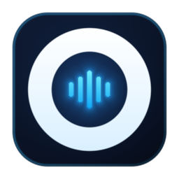

<div align="center">
  

  # Opung — Office Proximity Ultra Noise Gate

  **Peredam Bising Radius &le; 1.0 Meter &amp; Penjernih Vokal Studio HD 48 kHz untuk macOS, Windows, Google Meet &amp; Zoom**

  [-0284c7?style=flat-square&logo=apple&logoColor=white)](#panduan-instalasi--penggunaan)
  [-10b981?style=flat-square&logo=windows&logoColor=white)](#arsitektur-native-windows-opung-windows-x64exe)
  [](#4-mesin-audio-pintar-otomatis)
  [](#lisensi--kredit)
  [](LICENSE)
</div>

---

## Ringkasan Proyek

**Opung** (*Office Proximity Ultra Noise Gate*) adalah aplikasi peredam kebisingan jarak dekat (*near-field proximity noise gate*) dan penjernih vokal *real-time* untuk **macOS** dan **Windows** yang dirancang khusus untuk rapat daring (**Google Meet**, **Zoom**, **Microsoft Teams**, **Slack**, dan **Discord**) dari ruang kantor terbuka (*open-space office*), *co-working space*, maupun ruangan yang ramai.

Berbeda dengan peredam bising bawaan laptop yang masih sering meloloskan suara rekan kerja yang mengobrol di meja sebelah (karena sama-sama dikenali sebagai frekuensi suara manusia), **Opung** mengunci fokus tangkapan mikrofon hanya pada **radius &le; 1.0 meter** di depan pembicara utama, mengupas bising alat berat/ketikan *keyboard* saat berbicara, serta memoles vokal dengan **5-Stage Studio HD Equalizer** secara otomatis.

---

## Fitur Utama

| Fitur | Kemampuan Teknis | Manfaat Saat Rapat |
| :--- | :--- | :--- |
| **Gerbang Radius &le; 1.0 Meter** | *Hard Proximity Gate* dengan 3 preset jarak (`0.5m Dekat`, `1.0m Kantor`, `1.5m Ruang`) | Suara obrolan rekan kerja di meja sebelah (&ge; 1.5m) diputus mutlak ke `0.00x` (`-90 dB`) |
| **Pengupas Bising Saat Bicara** | *Hybrid Real RNNoise 0.2 WASM* (Xiph.org Neural GRU) + *ZCR Discriminator* | Suara bor bangunan, deru kipas, dan ketikan *mechanical keyboard* dikupas bersih bahkan saat Anda sedang berbicara |
| **Penjernih Vokal Studio HD** | *5-Stage Parametric EQ* (`48 kHz`) + *Soft-Knee Studio Compressor* | Menghilangkan suara mendem/kaleng (*Anti-Mud 260 Hz*) dan mengangkat artikulasi vokal (`+4.5 dB @ 3.5 kHz`) |
| **Anti-Bocor Speaker & Anti-Goa** | *Hardware AEC* + *Echo Guard Decay Tracker* | Mencegah suara dari speaker MacBook atau laptop Windows memantul kembali ke mikrofon saat rapat tanpa *earphone* |
| **Native macOS (Menu Bar)** | Objective-C (`Cocoa` + `NSStatusBar` + `WKWebView` + `CoreAudio HAL`) &rarr; `BlackHole 2ch` | Muncul di Menu Bar atas macOS, offline WebAssembly, beban CPU `< 2%` |
| **Native Windows (System Tray)** | `.NET 8 WinForms` + `Edge WebView2` + `NAudio WASAPI` &rarr; `VB-CABLE` | Berjalan di System Tray Windows 10/11 dalam satu file `Opung-Windows-x64.exe` |

---

## 4 Mesin Audio Pintar (Otomatis Aktif)

Opung menggabungkan **Arsitektur Hybrid** yang bekerja *real-time* pada *frame* `480 sampel` (`10 ms` @ `48 kHz`) begitu **1 Sakelar Utama** dinyalakan:

### 1. Sidechain Formant Detector & Proximity Gate (&le; 1.0 Meter)
- Mengukur energi akustik khusus pada pita frekuensi pita suara manusia (*Formant F0–F3*, `120 Hz – 3.100 Hz`) setelah dibersihkan oleh jaringan saraf RNNoise.
- Dilengkapi 3 pilihan sensitivitas jarak instan:
  - **Dekat (`0.5m` / `-20 dB`)**: Mode super ketat untuk ruang kerja yang sangat bising.
  - **Kantor (`1.0m` / `-26 dB`)**: Pengaturan ideal untuk memblokir obrolan meja sebelah.
  - **Ruang (`1.5m` / `-38 dB`)**: Pengaturan lebih longgar untuk ruang kerja pribadi.
- Setiap suara di bawah ambang batas jarak—termasuk suara rekan kerja di meja sebelah yang berbicara/mengajar *online*—langsung ditutup ke **`Gain = 0.00x`** dengan *hold time* alami (`260 ms`) agar suku kata akhir dan konsonan (`S`, `T`, `K`) tidak pernah terpotong.

### 2. Real RNNoise 0.2 WASM Neural Denoiser & ZCR Fusion
- Menjalankan model **RNNoise 0.2** (`@jitsi/rnnoise-wasm`, Xiph.org *Recurrent Neural Network*) secara lokal dan *offline* di WebAssembly tanpa mengirim audio ke server mana pun.
- Mengupas kebisingan non-manusia seperti suara bor, desis kipas, dan klik *mechanical keyboard* di 22 pita frekuensi **bahkan ketika Anda sedang berbicara**.
- Dilengkapi *Zero-Crossing Rate* (`ZCR > 135`) + *Neural VAD Fusion* sehingga benda mati tidak menipu gerbang, serta *fallback* mulus ke *Wiener Spectral Subtraction* apabila WASM belum siap.

### 3. 5-Stage Studio HD Vocal Clarity Equalizer
Secara otomatis menjernihkan karakter suara mikrofon bawaan laptop melalui 5 tahapan filter biquad:
1. **Sub-Rumble High-Pass (`85 Hz`)**: Membuang getaran meja dan dengung AC frekuensi rendah.
2. **Chest Warmth Peaking (`135 Hz`, `+2.0 dB`)**: Memberikan bobot suara yang hangat dan bulat.
3. **Anti-Mud Cut (`260 Hz`, `-2.8 dB`)**: Menghilangkan efek suara mendem atau terdengar seperti di dalam ruangan tertutup.
4. **Vocal Presence Boost (`3.500 Hz`, `+4.5 dB`)**: Memperjelas artikulasi vokal agar tetap tajam di Google Meet & Zoom.
5. **Krisp Vocal Mask & Air Shelf (`4.600 Hz` Low-Pass / `6.500 Hz` High-Shelf)**: Menahan desis frekuensi tinggi di luar pita suara manusia.

### 4. Hardware AEC & Anti-Cave-Echo Guard
- Mengunci *Hardware Acoustic Echo Cancellation* (`echoCancellation: true`) agar tetap menyala setiap saat, baik ketika rapat menggunakan speaker laptop maupun saat menekan tombol **Tes Dengar Suara Sendiri (Gunakan Earphone)**.
- Dilengkapi *Echo Guard Decay Tracker* yang mencegah pantulan suara dari speaker (~120 ms kemudian) memicu ulang gerbang mikrofon sehingga bebas dari efek suara berulang seperti di dalam goa.

---

## Arsitektur Native macOS (`Opung.app` & `OPUNG-Installer.dmg`)

Aplikasi desktop macOS Opung **tidak menggunakan Electron**, melainkan dibangun menggunakan arsitektur **Native macOS** murni:

- **UI & Window Host**: Native Objective-C (`Cocoa`, `AppKit`, `NSStatusBar`, `WKWebView`) dengan jendela *floating panel* yang otomatis menyesuaikan tinggi konten (*Auto-Fit Window Height Bridge*).
- **Menu Bar Integration**: Menampilkan ikon resmi Opung di **macOS Menu Bar** kanan atas (sebelah indikator Wi-Fi/baterai).
- **CoreAudio HAL Bridge**: Menulis sampel PCM hasil pemrosesan DSP secara langsung ke perangkat **`BlackHole 2ch`** melalui `AudioUnit` (`kAudioUnitSubType_HALOutput`).
- **In-Browser HFS+ `.DMG` Generator (`src/utils/macosAppBuilder.ts`)**: Merakit disk image macOS asli (`OPUNG-Installer.dmg`) langsung di browser maupun lewat skrip `npx tsx scripts/build-dmg.mjs`.

---

## Arsitektur Native Windows (`Opung-Windows-x64.exe`)

Untuk Windows 10 dan Windows 11, proyek ini menyediakan host desktop **Native Windows** di folder `windows/`:

- **UI & System Tray Host (`windows/MainForm.cs`)**: Aplikasi `.NET 8 WinForms` single-file (`Opung-Windows-x64.exe`) menggunakan **Microsoft Edge WebView2** bawaan Windows, jendela kompak `390px` auto-fit tinggi konten, izin mikrofon otomatis, dan ikon **System Tray** di kanan bawah taskbar.
- **NAudio WASAPI Bridge**: Menerima audio bersih 48 kHz langsung dari mesin DSP Opung melalui `window.chrome.webview.postMessage` dan mengalirkannya via **WASAPI** ke driver virtual mic gratis **[VB-CABLE](https://vb-audio.com/Cable/)** (`CABLE Input (VB-Audio Virtual Cable)`).
- **Build Otomatis GitHub Releases**: Workflow `.github/workflows/release.yml` otomatis mengompilasi `Opung-Windows-x64.exe` di runner `windows-latest` dan menerbitkannya berdampingan dengan `OPUNG-Installer.dmg` di halaman **GitHub Releases**.
- **Fallback Portabel Web (`src/utils/windowsAppBuilder.ts`)**: Jika file `.exe` belum di-host di web server, tombol **Unduh untuk Windows (.exe)** tetap mengunduh `Opung-Windows-Launcher.zip` berisi `Opung-Windows.bat` (Edge App-mode) yang langsung bisa dijalankan di Windows tanpa instalasi rumit.

---

## Panduan Instalasi & Penggunaan

### Di macOS (`OPUNG-Installer.dmg`)
1. Unduh **`OPUNG-Installer.dmg`** dari web aplikasi atau halaman **GitHub Releases**.
2. Klik 2x **`OPUNG-Installer.dmg`**, lalu **geser (`drag & drop`) `Opung.app` ke folder `Applications`**.
3. Buka folder `Applications`, **Klik Kanan (2 jari) &rarr; Open** pada `Opung.app`.
4. Di pengaturan Audio **Google Meet / Zoom / Teams**, pilih Microphone: **`BlackHole 2ch`**.

### Di Windows 10 / 11 (`Opung-Windows-x64.exe`)
1. Pasang driver virtual mic gratis **[VB-Audio Virtual Cable (VB-CABLE)](https://vb-audio.com/Cable/)** (*Run as administrator* `VBCABLE_Setup_x64.exe` &rarr; *Install Driver*).
2. Unduh dan jalankan **`Opung-Windows-x64.exe`** dari **GitHub Releases** (atau ekstrak `Opung-Windows-Launcher.zip` dan klik 2x `Opung-Windows.bat`).
3. Pastikan status di jendela Opung berbunyi hijau **`Terhubung ke VB-CABLE ✓`**.
4. Di pengaturan Audio **Google Meet / Zoom / Teams**, pilih Microphone: **`CABLE Output (VB-Audio Virtual Cable)`**.

---

## Menjalankan & Mem-build Proyek Secara Lokal

### Prasyarat
- **Node.js** `v18+` atau `v20+` & **npm** `v9+`
- *(Opsional, untuk build `.exe` lokal di Windows)* **.NET 8 SDK** (`win-x64`)

### Perintah Development & Build
```bash
# 1. Instal dependensi
npm install

# 2. Jalankan server pengembangan web (http://localhost:3000)
npm run dev

# 3. Cek tipe TypeScript & build produksi web
npm run lint
npm run build

# 4. Cetak installer macOS (OPUNG-Installer.dmg)
npx tsx scripts/build-dmg.mjs

# 5. Siapkan aset & build Opung-Windows-x64.exe (di Windows dengan .NET 8 SDK)
npx tsx scripts/prepare-windows-assets.mjs
dotnet publish windows/Opung.csproj -c Release -r win-x64 --self-contained true -p:PublishSingleFile=true -o release-win
```

---

## Struktur Direktori

```text
├── .github/workflows/
│   └── release.yml                      # CI/CD build otomatis .dmg (macOS) & .exe (Windows) ke GitHub Releases
├── public/
│   ├── opung-icon.png                   # Ikon resmi aplikasi Opung
│   └── demo-*.mp3                       # Audio demo Bahasa Indonesia asli
├── scripts/
│   ├── build-dmg.mjs                    # Generator OPUNG-Installer.dmg lewat CLI
│   ├── generate-rnnoise-bundle.mjs      # Pembungkus offline @jitsi/rnnoise-wasm (RNNoise 0.2)
│   └── prepare-windows-assets.mjs       # Sinkronisasi index.html & AppIcon.ico ke project Windows
├── windows/
│   ├── Opung.csproj                     # Project .NET 8 WinForms single-file (WebView2 + NAudio)
│   ├── Program.cs                       # Entry point single-instance Windows
│   ├── MainForm.cs                      # System Tray, WebView2 Host & WASAPI VB-CABLE Bridge
│   └── Resources/                       # Aset tersemat (AppIcon.ico & index.html)
├── src/
│   ├── components/
│   │   └── MacOSDesktopAppWorkspace.tsx # Mesin Hybrid RNNoise WASM + jendela kontrol Opung
│   ├── utils/
│   │   ├── audioDeviceFilters.ts        # Klasifikasi perangkat virtual mic (BlackHole 2ch & VB-CABLE)
│   │   ├── hybridDspCore.ts             # Pure Hybrid DSP Core (RNNoise 0.2 + Proximity Gate)
│   │   ├── macosAppBuilder.ts           # Generator Native macOS Cocoa/HAL & HFS+ .DMG Builder
│   │   ├── rnnoiseEngine.ts             # Wrapper WASM @jitsi/rnnoise-wasm (lifecycle aman)
│   │   ├── rnnoiseSyncInline.ts         # Bundle offline RNNoise 0.2 WASM untuk desktop app
│   │   └── windowsAppBuilder.ts         # Generator .ICO & Windows Launcher .ZIP fallback
│   ├── App.tsx                          # Halaman utama, pemutar uji banding & panduan macOS/Windows
│   ├── main.tsx                         # Entry point aplikasi React
│   └── index.css                        # Konfigurasi tema gelap & tipografi Tailwind CSS
├── LICENSE                              # MIT License (Copyright (c) 2026 Muhammad Zen)
├── index.html                           # Entry HTML & metadata SEO/OpenGraph
└── package.json                         # Konfigurasi skrip dan dependensi proyek
```

---

## Lisensi & Kredit

Proyek ini dilisensikan di bawah **[MIT License](LICENSE)**.

<div align="center">
  <p>
    <strong>Opung - Office Proximity Ultra Noise Gate · Versi 1.0</strong><br />
    &copy; 2026 Opung &middot; Made with &hearts; by <strong>Muhammad Zen</strong>
  </p>
</div>
